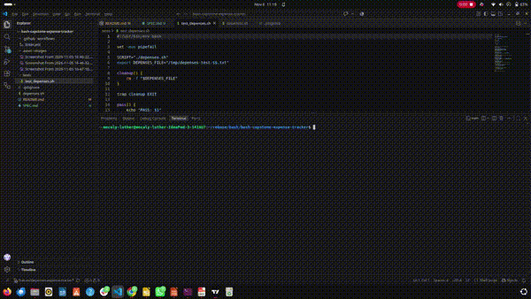

# Personal Expense Tracker – depenses

## Project Description

`depenses` is a Bash command-line application that helps users record, manage, and calculate their daily expenses.

It allows users to add expenses, view recorded expenses, delete expenses, calculate total spending, and generate a monthly report by category.

## Features

- Add a new expense with an amount, category, and optional note.
- Display all recorded expenses in aligned columns.
- Delete an expense using its unique ID.
- Calculate total expenses.
- Generate a monthly expense report grouped by category.
- Display help instructions.
- Validate user input and reject invalid amounts or IDs.

## 📷 Screenshots and demo




## Requirements

- Linux operating system (Ubuntu recommended).
- Bash.
- AWK.
- Standard Linux utilities such as `date`, `mkdir`, `mktemp`, and `mv`.

## Installation

Clone the repository:

```bash
git clone https://github.com/Mecaly-kjr/bash-capstone-expense-tracker.git
```

Enter the project directory:

```bash
cd bash-capstone-expense-tracker
```

Make the script executable:

```bash
chmod +x depenses.sh
```

## How to Run

### 1. Display Help

```bash
./depenses.sh help
```

### 2. Category Rules

Category names can contain only letters, numbers, underscores (_) and hyphens (-).

Examples of valid categories:

- Food
- Transport
- School_Fees
- Personal-Care

Spaces are not allowed in category names.

### 3. Add Expenses

```bash
./depenses.sh add 1500 Food Lunch
./depenses.sh add 500 Transport Taxi
./depenses.sh add 1000 Food Dinner
```

Example output:

```text
Expense added successfully!
ID: 1
Amount: 1500 FCFA
Category: Food
Date: 2026-11-05
```

### 4. List Expenses

```bash
./depenses.sh list
```

Example output:

```text
ID    AMOUNT       CATEGORY        DATE         NOTE
--------------------------------------------------------------
1     1500         Food            2026-11-05   Lunch
2     500          Transport       2026-11-05   Taxi
3     1000         Food            2026-11-05   Dinner
```

### 5. Calculate Total Expenses

```bash
./depenses.sh total
```

Example output:

```text
Number of expenses: 3
Total expenses: 3000.00 FCFA
```

### 6. Generate Monthly Report

```bash
./depenses.sh month
```

Example output:

```text
Expense report for 2026-11

CATEGORY             TOTAL (FCFA)
---------------------------------------
Food                 2500.00
Transport            500.00
---------------------------------------
TOTAL                3000.00
Number of expenses: 3
```

### 7. Delete an Expense

```bash
./depenses.sh delete 2
```

Example output:

```text
Expense 2 deleted successfully.
```

### 8. Handle Invalid Input

```bash
./depenses.sh add -100 Food Lunch
```

Example output:

```text
Error: Amount must be positive and have at most two decimal places.
```

## Data Storage

Expenses are stored locally in:

```text
~/.local/share/depenses/expenses.txt
```

The application uses tab-separated fields in this order:

```text
ID    AMOUNT    CATEGORY    DATE    NOTE
```

Example:

```text
1    1500    Food    2026-11-05    Lunch
2    500     Transport    2026-11-05    Taxi
```

The application automatically creates the storage directory and data file when needed.

You can also specify a temporary storage file for testing:

```bash
export DEPENSES_FILE=/tmp/depenses-test.txt
```

## Running Tests

The project includes automated tests in the `tests/` directory.

Make the test script executable:

```bash
chmod +x tests/test_depenses.sh
```

Run the tests:

```bash
./tests/test_depenses.sh
```

Actual test output:

```text
PASS: Help command
PASS: Adding expenses
PASS: Listing expenses
PASS: Total calculation
PASS: Monthly report
PASS: Deleting expenses
PASS: Invalid amount rejected
PASS: Unknown ID rejected

All tests passed successfully!
```

## Code Quality Checks

Check Bash syntax:

```bash
bash -n depenses.sh
```

Run ShellCheck:

```bash
shellcheck depenses.sh
```

## Project Structure

```text
bash-capstone-expense-tracker/
│
├── depenses.sh
├── README.md
├── tests/
│   └── test_depenses.sh
├── .gitignore
├── .github/
└── asset/
```

## Technologies Used

- Bash – application logic and command handling.
- AWK – expense calculations and monthly reports.
- Linux utilities – file management and storage.
- ShellCheck – code quality checking.

## 👨🏽‍💻 Author

Mecaly Luther Bobbilla

[mecalyluther64@gmail.com](mailto:mecalyluther64@gmail.com)

Junior Developer | Software Engineering

Based in Cameroon.
